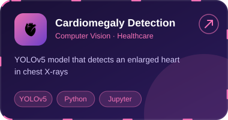
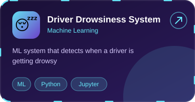
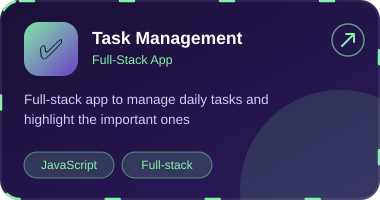
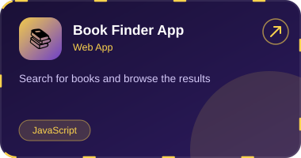
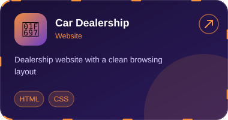
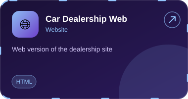

  

  

  
  
  
  

CSE student · UI/UX · Full-Stack · Machine Learning · Chennai

<h2 align="center">Featured Projects</h2>

  
  
  
  
  
  

<a href="https://github.com/poovarasan-arulganesh?tab=repositories">See all repositories</a>

<h2 align="center">Interactive Dashboard</h2>

  

<h2 align="center">Tech Stack</h2>

  

<h2 align="center">GitHub Stats</h2>

  

